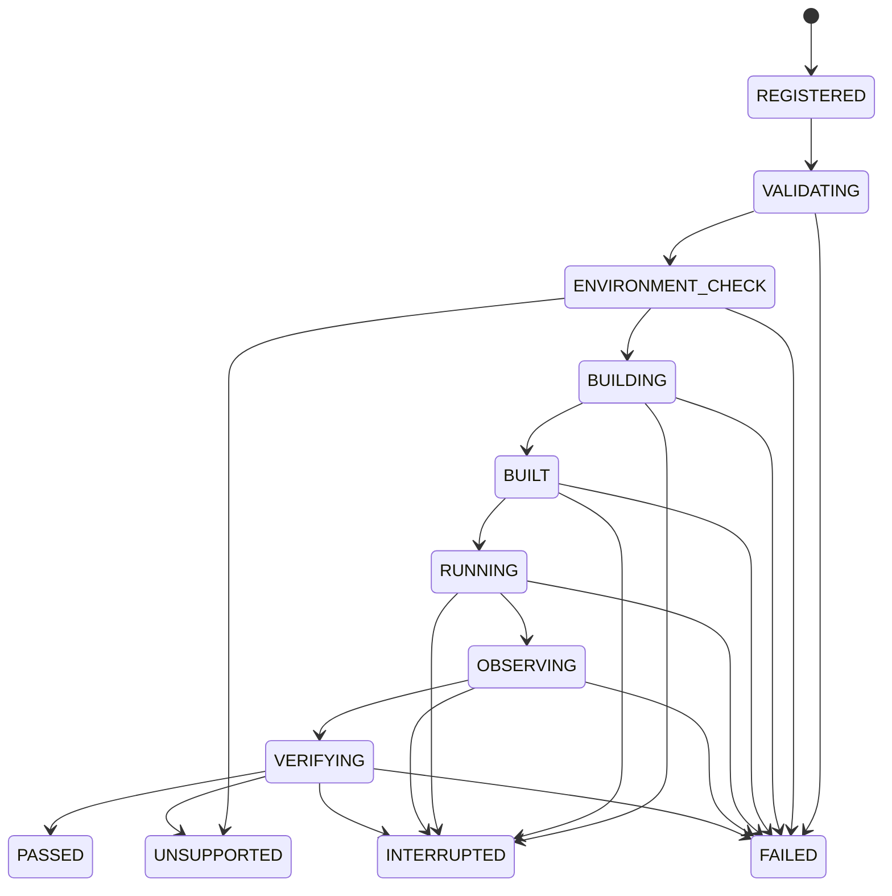

# 实验生命周期

`execute_session` 从 `REGISTERED` 出发，按下面的边迁移。每次迁移都记录时间和原因。终止状态不能再迁出。

`kernel_privileged` 和 `bare_metal` 在环境检查阶段进入 UNSUPPORTED。架构不在 manifest 列表中，或 `required_capabilities` 的状态不是 `ok`，也走这条边。

构建失败从 `BUILDING` 进入 `FAILED`，`failure_class` 为 `build`。验证失败的类别可以是 `verification`、`timed_out`、`output_limit` 或 `resource_limit`。实验打印 `status=unsupported` 时，即使退出码为 0，会话结果仍是 UNSUPPORTED。
