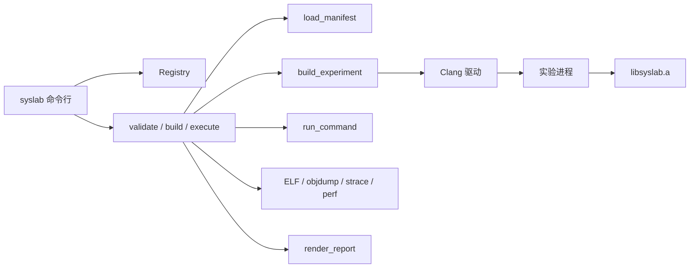

# 架构概览

SysLab 把机制库和实验运行器放在同一个静态库 `libsyslab.a` 中。命令行 `syslab` 只负责解析参数并调用会话函数。实验驱动是独立进程，通过链接该静态库使用机制，通过标准输出协议返回结果。

机制库不替换全局 `operator new`。分配器、锁、无锁结构和 fiber 都是显式对象。协程任务只在 `CoroutineScheduler::run` 中恢复，不会自己变成线程。

课程命令分成 `src/cli/learn/course.cpp`、`render_html.cpp`、`render_terminal.cpp` 和 `web_server.cpp`。`docs/learn/course.txt` 的第四栏可以带 `base` 或 `direction`，分别归入基础和方向；没有这两个记号的课归入进阶。页面和终端目录按这三层列出，课程文件本身也按基础、进阶、方向排列，打开页面时展开基础。一节页面先显示背景，再显示标题。标题下面是重点，然后列出上一事实、这一事实和下一事实，接着是图、名词和规则。换一组时在事实标题下标出那一组的名字。一组说明默认折起。成立的事实与机制不同时，机制收在「机制和程序」折叠区。一组的第一节放在名词之后。原理里先给规则，再给机制，有填数的课也在这里。原理之后是「先写下预期」，然后是成立的事实、本机演示和边界。`docs/learn/media` 里的 GIF 嵌进对应课的页面。每一节的本机演示都有一块预期观测，写在浏览器的 sessionStorage 里，按「对照观测」后才展开程序输出。OBJ-001、CPU-001、OS-002、AT-001 和 STO-002 的填数观察同样先收预期，再给出按规则算出的结果。本机执行仍用实验程序里的固定输入。课程编排单独成页，不放进 OBJ-001。页内说明基础、进阶、方向的范围，以及一节正文的组成。程序和核对在折叠区。成立的事实已经出现在正文时，本机演示不再重复同一段验证条件。清单的 `knowledge.prerequisites` 在课页上显示为「先看」，链接文字是前置课的标题。进阶接在基础的共享计数之后，先是其他锁和内存序，再扩到其余系统事实。`docs/learn/brief.txt` 的「证明」段显示为「成立的事实」。`docs/learn/brief.txt` 的「名词」段在「重点」之前显示。方向课放在 `experiments/storage`、`experiments/server`、`experiments/container`、`experiments/security`、`experiments/media` 和 `experiments/agent`。`track_neighbor` 在方向组内给出「下一事实」，在下一条业务线给出「另一方向」。容器实验调用 `experiments/common/userns.hpp` 的 `syslab_enter_user_namespace`，先建立用户命名空间并映射为 0，再使用 PID 命名空间、挂载命名空间、UTS 命名空间、网络命名空间或 `chroot`。`execute_session` 里不受支持、构建失败、运行前中断和一次运行都没有完成时的中断，都经过 `finish_session` 写入状态和摘要。运行、观测、验证和报告仍在 `execute_session` 中按这个顺序执行。

运行产物写到源码树的 `artifacts/`。每次运行向 `artifacts/index.jsonl` 追加一行，字段是 `experiment_id`、`directory` 和 `build_id`。`artifacts/latest/<id>.txt` 保存该实验最近一次运行目录。构建缓存写在 `artifacts/cache/`。`syslab clean --keep N` 按实验保留目录名最新的 N 个 `batch-*` 运行目录，以及这些运行引用的构建目录，然后重写索引并更新 `latest/<id>.txt`。单次运行目录里的 `report.md` 不会在后续运行中被改写。
