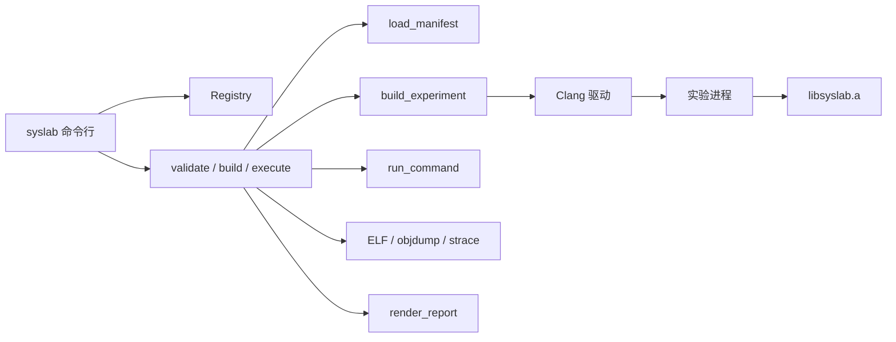

# 架构概览

SysLab 把机制库和实验运行器放在同一个静态库 `libsyslab.a` 中。命令行 `syslab` 只负责解析参数并调用会话函数。实验驱动是独立进程，通过链接该静态库使用机制，通过标准输出协议返回结果。

机制库不替换全局 `operator new`。分配器、锁、无锁结构和 fiber 都是显式对象。协程任务只在 `CoroutineScheduler::run` 中恢复，不会自己变成线程。

运行产物写到源码树的 `artifacts/`。`artifacts/latest/<id>.txt` 和 `artifacts/index.jsonl` 只保存最近一次运行目录，不改写该次运行里的 `report.md`。
